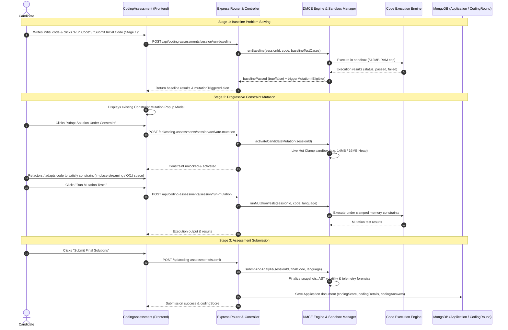

# Hire1Percent — Constraint Mutation Engine + AI Code Change Analysis + Assessment Integrity Detection
## Phase 1 Baseline Implementation & Architecture Audit

### 1. Executive Summary & Audit Context
This audit establishes the baseline discovery and architectural verification for introducing **Immutable Revision Tracking**, **AI Code Change Analysis (Gemini)**, and **Assessment Integrity Detection** into the Hire1Percent technical assessment platform.

Existing workflows, scores, code execution engines, timers, and candidate assessment experiences are protected and guaranteed to remain backward-compatible.

---

### 2. Existing Workflow & Architecture Diagram



---

### 3. Relevant Source Files Audited

#### Backend Source Files
- **Routes**: `backend/routes/codingAssessmentRoutes.js` (Routes: `/round`, `/submit`, `/run`, `/session/start`, `/session/run-baseline`, `/session/activate-mutation`, `/session/run-mutation`, `/session/status/:sessionId`, `/session/telemetry`)
- **Controllers**: `backend/controllers/codingAssessmentController.js` (Master controller handling round lifecycle, submissions, and DMCE integration)
- **DMCE Engine**:
  - `backend/services/dmce/mutationEngine.js` (Orchestrates sandbox lifecycle, trigger checks, baseline runs, and mutation tests)
  - `backend/services/dmce/sessionManager.js` (Lifecycle states, snapshots: `baselineCode`, `preMutationCode`, `postMutationCode`, `finalSubmittedCode`)
  - `backend/services/dmce/sandboxManager.js` (Process execution, resource clamping to 14MB/16MB, timeout enforcement)
  - `backend/services/dmce/mutationRegistry.js` (Contracts: `mut_mem_opt_14mb`, `mut_mem_opt_16mb`, `mut_stream_100k`)
  - `backend/services/dmce/mutationTrigger.js` (AST node counts and Gemini code intent verification)
  - `backend/services/dmce/forensicsEngine.js` (Calculates CAS score, spatial locality, keystroke monotonicity, and diagnostic interactivity)
- **AI Integration**: `backend/utils/aiClients.js` (`callGemini`, `safeParseAIJson` using model `gemini-2.5-flash`)
- **Models**:
  - `backend/models/Application.js` (Authoritative candidate record containing `codingAnswers`, `codingDetails`, `codingScore`, `snapshots`, `forensics`, `mutation`)
  - `backend/models/CodingRound.js` (Job assessment configuration, dynamic mutation settings)
  - `backend/models/CodingQuestion.js` (Questions, difficulty, testCases, constraints)

#### Frontend Source Files
- `frontend/src/pages/seeker/ApplicationFlow/CodingAssessment.jsx` (Candidate coding assessment interface, timer, Monaco/code editor, Stage 1 / Stage 2 buttons, mutation alert modal)
- `frontend/src/pages/SampleReportPage.jsx` & `frontend/src/pages/SampleReportPage.css` (Recruiter audit report showing candidate metrics, AST code evolution, live adaptation, and authorship signals)

---

### 4. Current API Contracts & Database Schema

#### Coding Assessment Submission Contract (`POST /api/coding-assessments/submit`)
- **Request Body**:
  ```json
  {
    "jobId": "ObjectId",
    "userId": "string",
    "answers": [
      {
        "questionId": "ObjectId",
        "code": "string",
        "language": "string",
        "sessionId": "string",
        "stage1Code": "string",
        "stage2Code": "string",
        "stage1SubmittedAt": "number",
        "stage2SubmittedAt": "number"
      }
    ]
  }
  ```
- **Response**:
  ```json
  {
    "success": true,
    "codingScore": 85,
    "percentageScore": 85,
    "codingDetails": {
      "totalQuestions": 2,
      "totalMaximumMarks": 100,
      "totalObtainedMarks": 85,
      "dmceSummary": {
        "mutationsTriggered": 1,
        "mutationsPassed": 1,
        "totalQuestionsWithDMCE": 1,
        "overallCasScore": 88
      }
    }
  }
  ```

#### MongoDB Representation (`Application.codingAnswers`)
- Stores: `questionId`, `code`, `language`, `score`, `obtainedMarks`, `testCasesPassed`, `execution`, `baseline`, `mutation`, `forensics`, `snapshots` (`baselineCode`, `preMutationCode`, `postMutationCode`, `finalSubmittedCode`), and `sandboxSessionId`.
- Preserves all historical records without breaking legacy documents.

---

### 5. Baseline Test & Build Execution Record

| Test Suite / Command | Target / Scope | Result | Details |
|---|---|---|---|
| `node tests/codingScoreCalculator.test.js` | Backend scoring & normalization | **33 Passed, 0 Failed** | Verifies strictly 100 marks normalization across 1-5 questions of varying difficulties |
| `node tests/dmce.test.js` | DMCE Engine & Sandbox | **35 Passed, 0 Failed** | 16 test groups: sandbox isolation, memory clamp, OOM vs Stream, AST volatility, concurrent sessions |
| `node tests/dmceForensicFix.test.js` | Test case resolver & memory limits | **27 Passed, 0 Failed** | Resolves falsy test case values, custom memory limits, idempotent mutation activation |
| `node --check server.js` | Node syntax verification | **Passed (Exit code 0)** | Clean syntax |
| `npm run build` (Frontend) | Vite production bundle + SEO Prerender | **Passed (Exit code 0)** | 15 routes prerendered with unique canonical tags in 1m 28s |
| `npm run lint` (Frontend) | ESLint across entire repository | **534 Pre-existing issues** | Pre-existing unused variables across unrelated pages (e.g. `motion` imports, `Icon`); does not impede build |

---

### 6. Planned Additive Changes (Minimal & Safe)

1. **`backend/models/CodeRevision.js`**:
   - New MongoDB schema for immutable append-only revision records.
   - Fields: `assessmentId`, `candidateId`, `questionId`, `originalSubmissionId`, `baselineRevisionId`, `revisionId`, `sequenceNumber`, `language`, `constraintId`, `constraintVersion`, `timestamp`, `previousRevisionId`, `codeSnapshot`, `contentHash`, `runAttemptId`, `finalSubmissionRef`, `revisionType` (`BASELINE`, `MUTATION_ACTIVE`, `INTERMEDIATE_RUN`, `CHECKPOINT`, `FINAL_SUBMISSION`).
   - Compound indexes: `{ assessmentId: 1, candidateId: 1, questionId: 1, sequenceNumber: 1 }` and `{ contentHash: 1 }`.
   - Automatic deduplication of identical consecutive snapshots.

2. **`backend/services/revisionTrackingService.js`**:
   - Isolated service to append revisions, verify baseline immutability, recover snapshots, and enforce cross-candidate authorization.
   - Bounded snapshot size protection (max 256KB per snapshot).

3. **`backend/services/aiCodeChangeAnalysisService.js`**:
   - AI code change analyzer reusing `callGemini` from `backend/utils/aiClients.js`.
   - Evaluates: technical relevance, algorithm preservation, memory strategy adaptation, execution evidence consistency, and human review recommendation.
   - Strict fairness guards: rewrites, style shifts, diff size, and algorithmic changes are NEVER flagged as cheating.
   - Candidate code wrapped inside delimiter tokens to prevent prompt injection.

4. **`backend/services/integrityAnalysisQueue.js`**:
   - Asynchronous background worker for processing AI integrity analysis without blocking Run/Submit requests.
   - Idempotency, timeout handling, and bounded retry mechanism.

5. **API & Controller Integrations**:
   - Additive hooks in `codingAssessmentController.js`:
     - Record `BASELINE` revision on baseline pass.
     - Record `MUTATION_ACTIVE` revision on constraint activation.
     - Record `INTERMEDIATE_RUN` on mutation code executions.
     - Record `FINAL_SUBMISSION` on submit and enqueue asynchronous AI analysis.
   - Compatible endpoints:
     - `GET /api/coding-assessments/revisions/:applicationId/:questionId`
     - `GET /api/coding-assessments/integrity-analysis/:applicationId/:questionId`

6. **Feature Flag**:
   - `CONSTRAINT_MUTATION_ANALYSIS_ENABLED` (defaults to true; if false, safely bypasses revision/AI hooks while preserving all existing assessment workflows).

---

### 7. Protected Components and Invariants

- **Baseline Score Invariant**: Baseline credit is 100% preserved and authoritative. AI analysis never deducts marks or overwrites test-case evaluation.
- **UI Invariant**: The candidate code editor, timers, navigation, and existing "Adapt Solution Under Constraint" modal remain unchanged.
- **Security Invariant**: Cross-candidate access to revision history or constraint state is rejected with 403 Forbidden.
- **Gemini Safety Invariant**: Gemini API errors, timeouts, or invalid responses never result in candidate disqualification or cheating flags; failures are recorded as `analysisStatus: 'failed'` or `insufficient_evidence` with eligibility for recruiter review.
